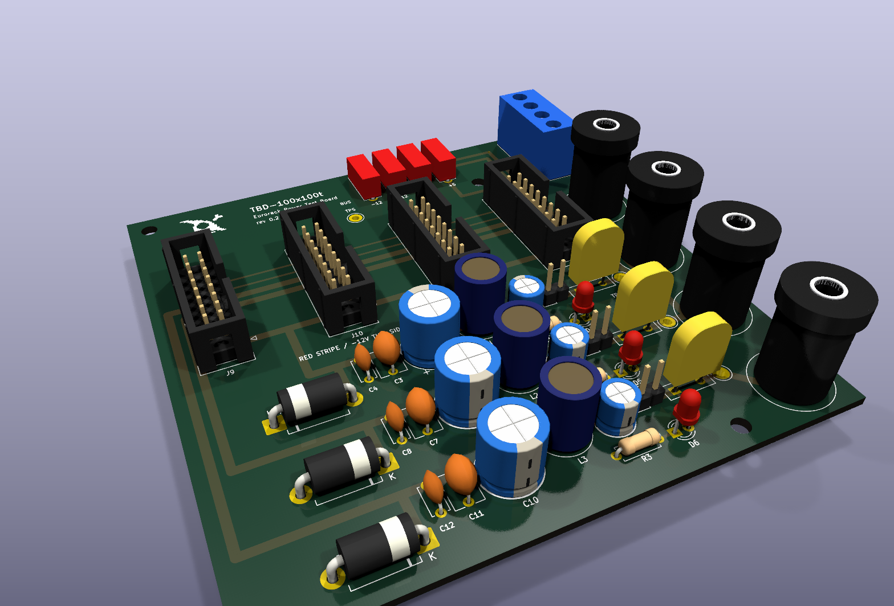

# TBD100x100t Eurorack Test Bench Power Distribution
 Eurorack distribution board with banana jack sockets for inputs and test probe sockets and a terminal block at the end of the circuit.

 

 This is part of a series of 100mm x 100mm Power Distribution boards I'm putting together. There is also a default board and an extension board.
 The size was chosen to allow for cheap manufacture with the prototype PCB providers.

 TBD-100x100t is intended for test bench usage: checking DIY modules and power supplies before they go anywhere near a rack. I run mine from a Mean Well triple output supply (+12v, -12v and 5v) in an enclosure with banana jacks.

## Rev 0.2 - now in KiCad
 The board was originally drawn in DipTrace back in 2020. It has now been migrated to KiCad 9 and reworked to fix some issues with that original draft.
 I have not had rev 0.2 manufactured yet, so it is untested at this time. It passes KiCad's ERC and DRC checks.

 What changed from the original draft:
 - The 5v rail is finished. On the original the 5v bus was never joined to its filter, two of its capacitors were not grounded and 5v never reached the terminal block.
 - Four 16 pin headers instead of six. The original headers were too close together to use without skipping every other one, at least with the cables I had. They are now 22mm apart.
 - The banana jacks are on the standard 19.05mm spacing with 1.6mm holes. The original spacing and holes were too small for the Cal Test jacks in the BOM.
 - Each rail is still a Pi filter but with a 10uH inductor in place of the ferrite bead (which is now obsolete), and most of the capacitance moved to the bus side: 47uF, 10uH, then 1000uF with 10uF and 100nF ceramics.
 - Each rail has a resettable fuse, a Schottky diode to ground so a swapped lead trips the fuse, and an LED after the fuse.
 - Each rail has a two pin link. Pull the jumper and put a multimeter across the pins to read how much current a module draws.
 - Loop test points at each input show what the supply is delivering. The four test probe sockets are on the bus and show what the modules see. They now sit at the top edge of the board so a multimeter probe can reach them. There are two ground loops for an oscilloscope clip.

 The headers have pin 1 (-12v, the red stripe) at the bottom, same as the original.

## Files
 - `kicad/` is the KiCad 9 project: schematic and board.
 - `TBD100x100t_rev0.2_schematic.pdf` is the schematic.
 - `TBD100x100t_rev0.2_gerbers.zip` has the gerbers and drill files.
 - `TBD 100x100t  BOM.csv` has the parts and values with manufacturer part numbers.
 - `3drender.png` and `3drender-top.png` are renders of the board.
 - `original-diptrace/` keeps the 2020 DipTrace files, gerbers, BOM and render, plus `kicad-port/`, a KiCad copy of that original board exactly as it was drawn, faults included.

 The banana jack, test probe socket, fuse, terminal block and inductor footprints come from my [tbd-kicad](https://github.com/tbdtechpro/tbd-kicad) library. The board file carries its own copies so it opens without the library, but you will want it if you plan to edit those parts.

## Things to check before ordering
 - The test probe socket footprint follows the pattern from the 2020 board. Cinch only supplies the drawing on request, so I have not been able to verify it.
 - The header spacing is close to, but not exactly, the spacing I know works with my cables.
 - The -12v fuse is 1.1A like the other two, which is more than the 0.5A a Mean Well RT-65B is rated for on that rail.
